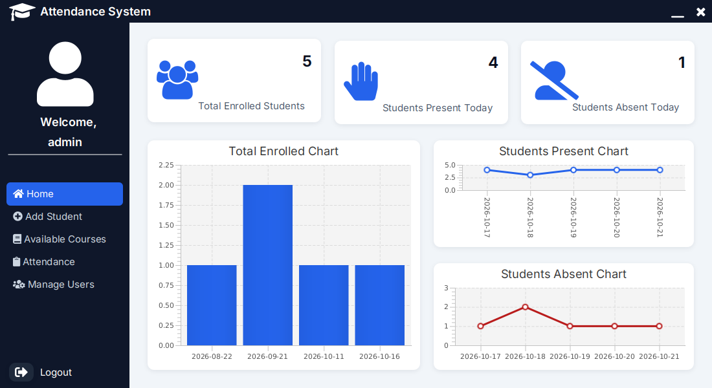
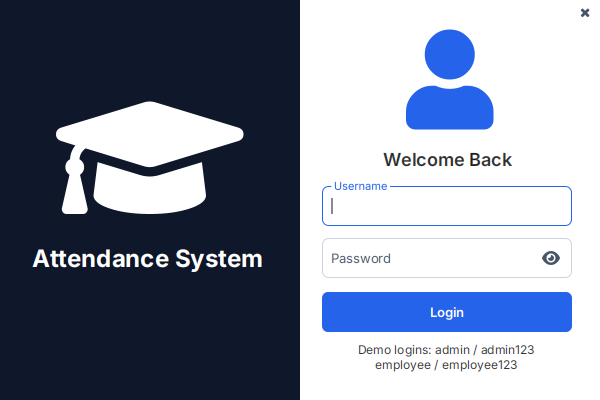
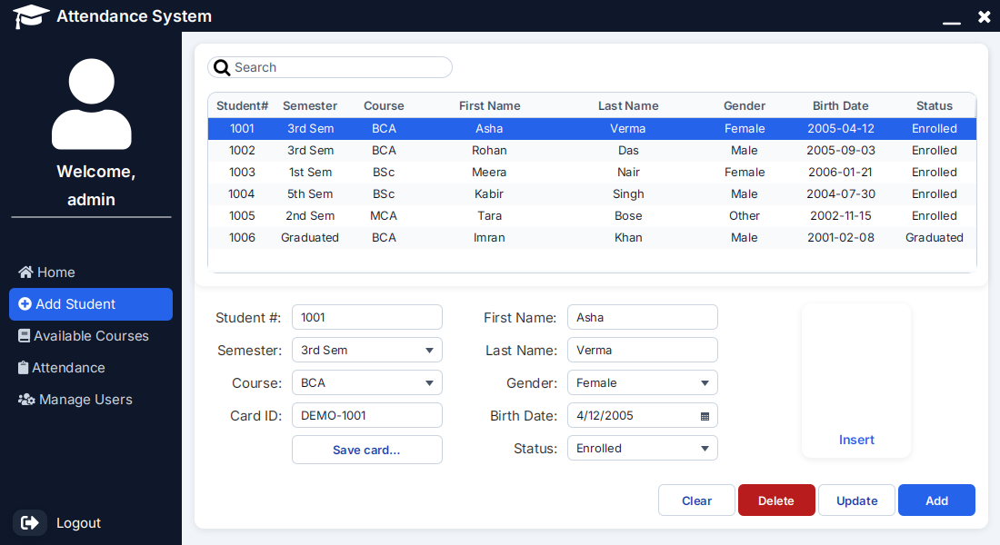
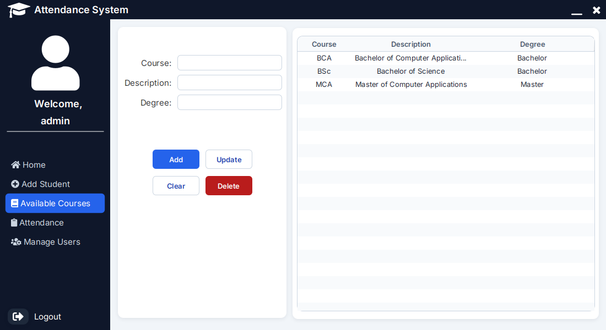
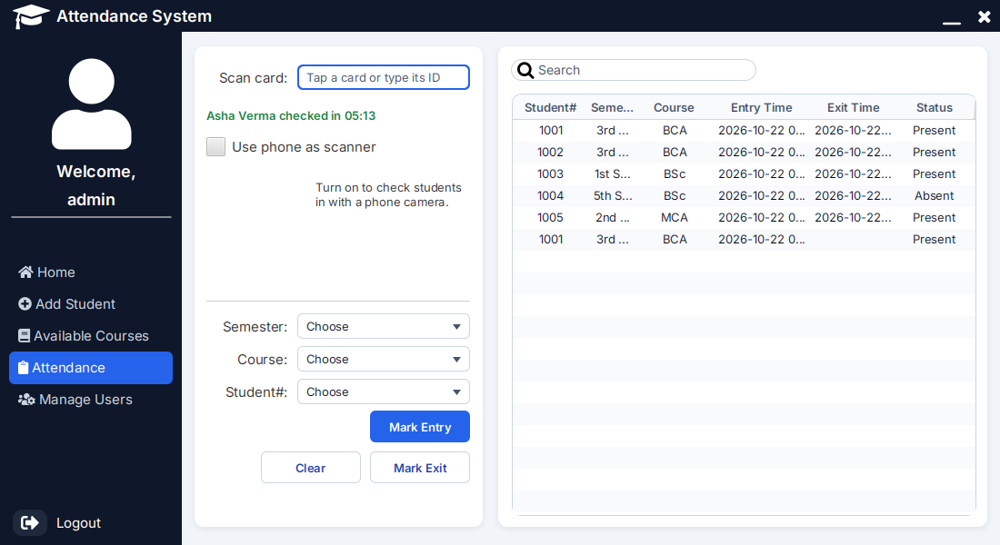
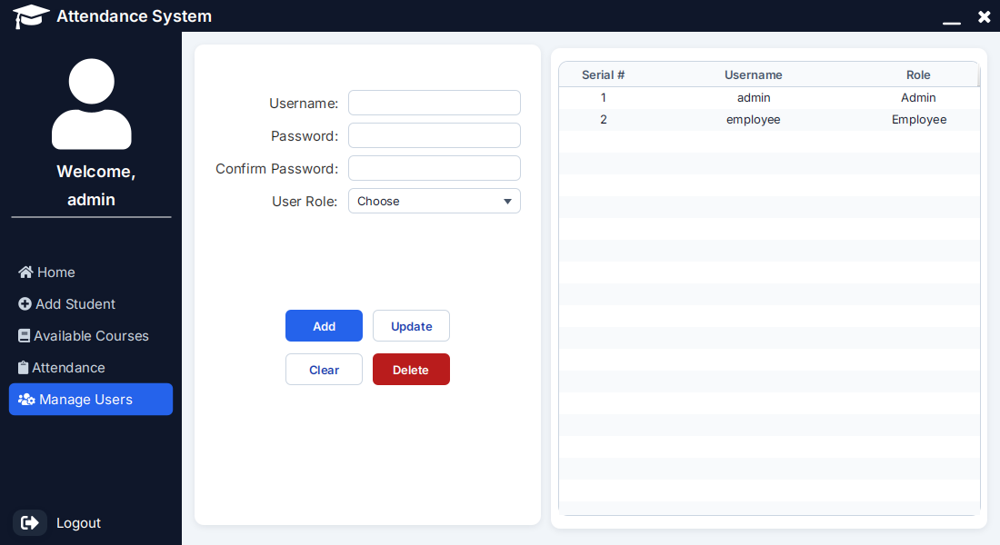
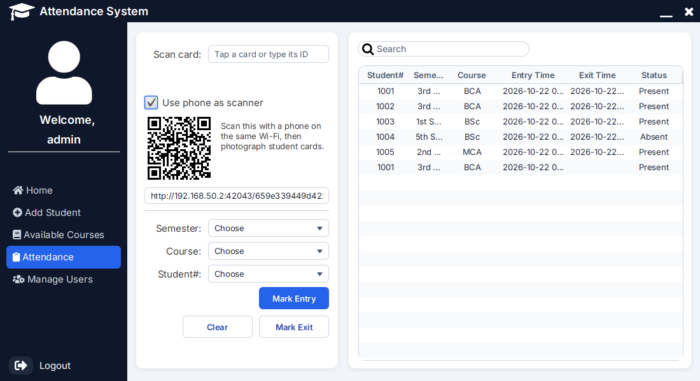

# Attendance System

A desktop app for keeping track of students, courses and attendance, built with JavaFX. It runs on
Windows, macOS and Linux. The database is embedded, so there is no server to install: clone, build,
and log in.



## Features

- **Login** with two roles. Passwords are stored as bcrypt hashes. An *Admin* can manage users;
  an *Employee* can't see that screen.
- **Dashboard** with totals and charts of present and absent students.
- **Students**: add, edit, delete and search, with an optional photo.
- **Courses**: add, edit and delete. A course that students still use can't be deleted.
- **Attendance**: record entry and exit times by picking a student, or by scanning their card.
- **Card scanning**: each student can have a card ID. An RFID reader, a barcode or QR scanner, or
  plain typing fills the scan field; the first scan of the day checks the student in, the next one
  checks them out. Each student's QR card can be saved as a PNG to print.
- **Phone as scanner**: no reader at hand? Switch on "Use phone as scanner", scan the pairing QR
  code with a phone on the same Wi-Fi, and photograph a student's QR card.
- **User management** (Admin only): add, edit and delete users and set their role. Nobody can
  delete themselves, and the last Admin can't be removed or made an Employee.

| Login | Students | Courses |
|---|---|---|
|  |  |  |
| **Attendance** | **User management** | **Phone scanner** |
|  |  |  |

## Try it

### Download

Each [GitHub Release](../../releases) has a ready-to-run build for Linux (`.deb` or `.tar.gz`),
Windows (`.zip`) and macOS (`.dmg`). It brings its own Java runtime, so nothing else needs to be
installed. The Windows and macOS builds aren't signed, so the first start shows a warning. On
Windows, click **More info** and then **Run anyway**. On macOS, right-click the app, choose
**Open** and confirm.

### Build from source

You need [JDK 25](https://adoptium.net/) or newer and [Git](https://git-scm.com/). Maven doesn't
need to be installed: `./mvnw` downloads the right version.

```sh
git clone https://github.com/XAPHNE/AttendanceSystem.git
cd AttendanceSystem
./mvnw javafx:run
```

On Windows, use `mvnw.cmd javafx:run`. The build stops with a clear message if your JDK is older
than 25. In IntelliJ IDEA, open the folder and run `AttendanceApplication`.

### Demo logins

On the first start the app creates its database and fills it with demo data: fictional students,
three courses and a few days of attendance.

| Username | Password | Role |
|---|---|---|
| `admin` | `admin123` | Admin |
| `employee` | `employee123` | Employee |

### Scan a card in 30 seconds

1. Log in as `admin` / `admin123` and open **Attendance**.
2. The **Scan card** field already has focus. Type `DEMO-1001` and press Enter: "Asha Verma
   checked in" appears and a new row shows up in the table. Every demo student has a card,
   `DEMO-1001` to `DEMO-1006`.
3. Wait a few seconds and scan `DEMO-1001` again to check her out.
4. Optional: tick **Use phone as scanner**, scan the QR code with your phone (same Wi-Fi), and
   type a card ID on the phone, or photograph a QR card saved with **Save card...** on the
   Add Student screen.

## Using an RFID reader

Almost every USB RFID reader, and most barcode and QR scanners, work in *keyboard mode*: the
computer sees them as a keyboard that types the card's number and presses Enter. So no driver or
setup is needed:

1. Plug the reader in.
2. On **Add Student**, select a student, click the **Card ID** field and tap their card. The
   reader types the ID; save the student.
3. On **Attendance**, tap the card. The scan field has focus, so the reader's Enter checks the
   student in or out.

Without a reader, typing the ID and pressing Enter does exactly the same thing. A second scan of
the same card within 5 seconds is ignored, so one tap doesn't check a student in and straight out
again.

## Tech stack

| Part | Choice |
|---|---|
| Language | Java 25 (LTS), one Java module |
| UI | JavaFX 27, FXML, MaterialFX, Ikonli icons, the Inter font |
| Database | H2 (embedded), schema managed by Flyway migrations |
| Passwords | bcrypt (jbcrypt) |
| QR cards | ZXing core |
| Phone scanner | The JDK's built-in HTTP server (`jdk.httpserver`) |
| Build | Maven (wrapper included), jlink and jpackage for installers |
| Tests | JUnit 6, AssertJ, TestFX, JaCoCo coverage gate |
| CI | GitHub Actions on Linux, Windows and macOS, Dependabot |

## Docs

- [Architecture](docs/architecture.md): the layers, startup, error handling, and what each test
  suite covers
- [Database](docs/database.md): the tables, an ER diagram and the migrations
- [Design decisions](docs/decisions.md): why H2 and not MySQL (and how to switch), why Flyway,
  DAOs and bcrypt, card readers and the phone scanner, the UI design, and the known gaps

## Where the data is stored

The database and student photos live in a per-user folder, so the app works from any install
location:

| OS      | Folder                                                          |
|---------|-----------------------------------------------------------------|
| Windows | `%APPDATA%\AttendanceSystem`                                    |
| macOS   | `~/Library/Application Support/AttendanceSystem`                |
| Linux   | `$XDG_DATA_HOME/AttendanceSystem` (default `~/.local/share/AttendanceSystem`) |

Delete that folder to start over with fresh demo data. To use another folder, start the app with
`-Dattendance.home=<folder>`. To use another database, set `ATTENDANCE_DB_URL`,
`ATTENDANCE_DB_USER` and `ATTENDANCE_DB_PASSWORD`.

The schema is created and upgraded by [Flyway](https://documentation.red-gate.com/flyway) from the
SQL files in `src/main/resources/db/migration`. To change the schema, add a new
`V<next number>__<description>.sql` file there; never edit a file that has already been released.

Earlier versions kept the database in the project's `data/` folder. That folder is no longer used.

## Running the tests

Run `./mvnw verify` (Windows: `mvnw.cmd verify`).

- The UI tests open the real app and click through it, so they need a display. On a Linux machine
  without one (a server or CI runner) they are skipped; run `xvfb-run ./mvnw verify` to include
  them. `./mvnw verify -DexcludedGroups=ui` skips them anywhere.
- The build fails if the tests cover less than 90% of the lines in the `dao`, `service` and
  `scanner` packages. The coverage report is at `target/site/jacoco/index.html`.
- GitHub Actions runs the same build with the UI tests on Linux, Windows and macOS for every push
  and pull request (`.github/workflows/ci.yml`). A separate job tries the newest Java (27) as an
  early warning; it is allowed to fail.

## Building a version that runs without Java

Run `./mvnw -Pdist clean package` (Windows: `mvnw.cmd -Pdist clean package`).
`target/dist/AttendanceSystem` is then a folder with the app and its own small Java runtime. Copy
it to any computer with the same operating system and start `bin/AttendanceSystem` (Windows:
`AttendanceSystem.exe`, macOS: `AttendanceSystem.app`). That computer doesn't need Java installed.

To build an installer instead, add `-Ddist.type=` followed by the type:

| OS      | Type  | Note                                                                                              |
|---------|-------|---------------------------------------------------------------------------------------------------|
| Linux   | `DEB` | Needs `fakeroot`. Add `-Ddist.shortcuts=true -Ddist.linux-deps=libgtk-3-0` for a menu entry and the GTK dependency |
| Windows | `MSI` | Needs the [WiX Toolset](https://wixtoolset.org/)                                                  |
| macOS   | `DMG` |                                                                                                   |

How it works: jlink builds a Java runtime that holds only the JDK modules the app needs. jpackage
puts that runtime, the app and its libraries in one folder or installer. H2, Flyway and jbcrypt
and ZXing aren't Java modules, and jlink can't put those into a runtime, so they sit next to it
in `lib/app/mods`.

## Publishing a release

Push a version tag, for example `git tag v1.2.0 && git push origin v1.2.0`. The release workflow
(`.github/workflows/release.yml`) then builds the app on Linux, Windows and macOS and attaches the
results to a new GitHub Release:

| File                                     | What it is                                         |
|------------------------------------------|----------------------------------------------------|
| `AttendanceSystem-<version>-linux-amd64.deb` | Installer for Ubuntu and Debian, with a menu entry |
| `AttendanceSystem-<version>-linux-x64.tar.gz` | The app folder for any Linux; start `bin/AttendanceSystem` |
| `AttendanceSystem-<version>-windows-x64.zip` | The app folder for Windows; start `AttendanceSystem.exe` |
| `AttendanceSystem-<version>-macos-arm64.dmg` | The app for Macs with Apple silicon |

## Checking for dependency updates

Dependabot (`.github/dependabot.yml`) checks every week for newer libraries, build plugins, the
Maven version and GitHub Actions. It opens a pull request for them, and CI tests the update before
it is merged.

To check by hand, run `./mvnw versions:display-dependency-updates versions:display-plugin-updates`.
It lists newer stable releases of the libraries and build plugins.

## Editing the screens in SceneBuilder

The screens are FXML files in `src/main/resources/com/bsmi/attendancesystem/fxml`. To open them in
[SceneBuilder](https://gluonhq.com/products/scene-builder/), first add the libraries they use:

1. In SceneBuilder, click the gear icon next to **Library** and choose **JAR/FXML Manager**.
2. Click **Search repositories** and add each of these, then choose **Import Component**:
   - `io.github.palexdev:materialfx:11.17.0`
   - `org.kordamp.ikonli:ikonli-javafx:12.4.0`
   - `org.kordamp.ikonli:ikonli-fontawesome-pack:12.4.0`
   - `org.kordamp.ikonli:ikonli-fontawesome5-pack:12.4.0`

The look comes from the stylesheets in `src/main/resources/com/bsmi/attendancesystem/css`;
`theme.css` holds every color.

## License
This project is licensed under the GNU General Public License v3.0 - see the [LICENSE](/LICENSE) file for details.

For more information about the GNU GPL v3.0 license, please visit the [GNU website](https://www.gnu.org/licenses/gpl-3.0.en.html).

## Author
[Subhankar Sarkar](https://xaphne.github.io/about)

## Contributor
[Prithiraj Rabha](https://github.com/prithirabha)
