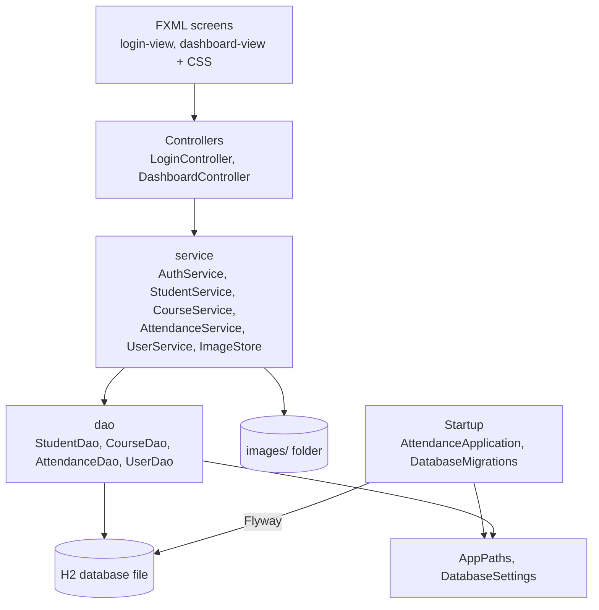

# Architecture

A JavaFX desktop app in one Java module (`com.bsmi.attendancesystem`), with three layers: screens,
services and DAOs. Each layer only calls the one below it.

## Startup and data folder

- `AttendanceApplication.init()` runs `DatabaseMigrations.applyPending`, which lets Flyway create
  or upgrade the schema. `start()` then loads the bundled Inter font and shows the login screen.
- `AppPaths` picks the per-user data folder:
  - Windows: `%APPDATA%\AttendanceSystem`
  - macOS: `~/Library/Application Support/AttendanceSystem`
  - Linux: `$XDG_DATA_HOME/AttendanceSystem`, or `~/.local/share/AttendanceSystem` if that isn't set
  - `-Dattendance.home=<folder>` overrides all of these, which demos and tests use.
- `DatabaseSettings` builds the H2 URL for that folder. The `ATTENDANCE_DB_URL`,
  `ATTENDANCE_DB_USER` and `ATTENDANCE_DB_PASSWORD` environment variables point the app at a
  different database.

## dao

The only code that runs SQL. Each DAO opens a connection through `Database.open()`, uses
`PreparedStatement` with `?` placeholders (so typed text can never become SQL), and closes
everything with try-with-resources. An `SQLException` becomes an unchecked `DataAccessException`
whose message names the operation, such as "delete course BCA".

## service

The rules, kept out of the controllers so they can be tested without a screen:

- `AuthService` checks a login against the bcrypt hash (`Passwords`). An unknown user, a wrong
  password and a broken hash all give the same "wrong username or password" answer.
- `StudentService`, `CourseService`, `AttendanceService` and `UserService` check forms and
  permissions, such as required fields, duplicates, a course still in use, or removing the last
  Admin.
- `ImageStore` copies a chosen photo into `images/` in the data folder under a random name, and
  stores only that name. It accepts only `.png`, `.jpg` and `.jpeg`, and refuses names that would
  point outside the folder.
- `UserSession` (in the main package) remembers who logged in, so the dashboard can hide User
  Management from Employees.

## Controllers and FXML

The screens are FXML files in `src/main/resources/com/bsmi/attendancesystem/fxml`, styled by
`theme.css` (color tokens) plus one stylesheet per screen. `LoginController` and
`DashboardController` read the form fields, call a service, and show the result. They hold no SQL
and no business rules.

## Errors

| Thrown by | Type | What the user sees |
|---|---|---|
| service | `ValidationException` subclasses (`MissingFieldException`, `AlreadyExistsException`, `StillInUseException`, ...) | An error alert with the exception's message, written for the user |
| dao | `DataAccessException` | A "database error" alert; the app keeps running |
| startup | `DatabaseSetupException` | JavaFX stops the launch and prints the cause. A friendlier dialog is a known gap |

## Tests

Run all of them with `./mvnw verify`.

| Suite | Covers |
|---|---|
| `dao/*Test` | Each DAO against its own in-memory H2 with the real migrations: CRUD, not-found, duplicates, injection strings stored as plain text, closed connections |
| `service/*Test` | Every validation rule and exception, every login outcome, photo copy and rejection |
| `AppPathsTest`, `DatabaseSettingsTest`, `DatabaseMigrationsTest`, ... | Folder choice per OS, env variables, a fresh and an already-current database, a broken one |
| `ui/*Test` (TestFX, tagged `ui`) | Login success and failure, form errors, course delete confirm/cancel, logout, the sidebar highlight |

- UI tests need a display. On Linux, CI gives them one with `xvfb-run`. Without a display they are skipped, and
  `-DexcludedGroups=ui` skips them on purpose.
- JaCoCo fails the build if line coverage of `dao` or `service` drops below 90%.
