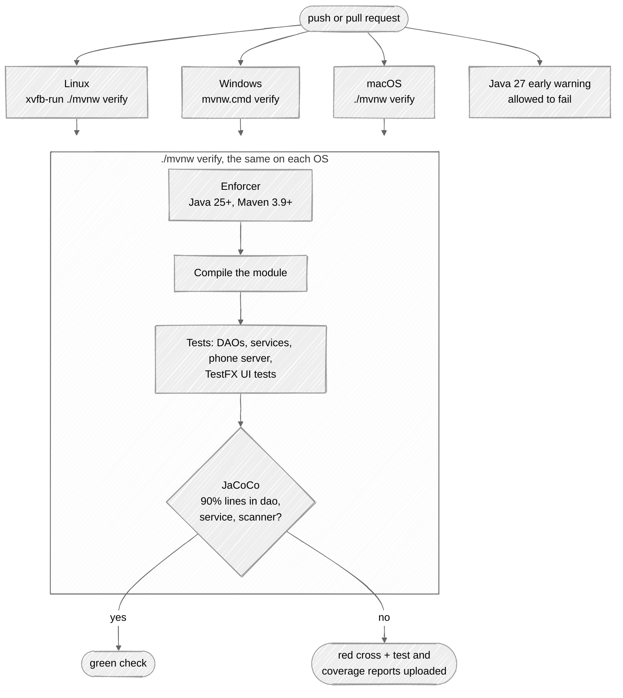
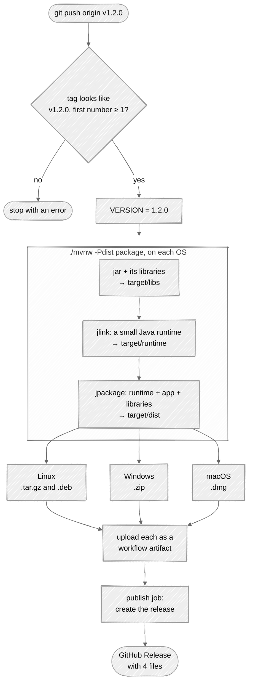

# Build and release

How GitHub Actions tests every change and turns a version tag into apps that run without Java.
The commands to run these steps yourself are in the README:
[Running the tests](../README.md#running-the-tests),
[Building a version that runs without Java](../README.md#building-a-version-that-runs-without-java)
and [Publishing a release](../README.md#publishing-a-release).

## CI: every push and pull request

`.github/workflows/ci.yml` runs `./mvnw -B verify` on Linux, Windows and macOS with Java 25. A
failure on one OS doesn't cancel the others (`fail-fast: false`), so one run shows every broken OS.



- The Maven wrapper downloads the Maven version in `.mvn/wrapper/maven-wrapper.properties`, so
  CI and your machine build with the same Maven. `setup-java` caches `~/.m2`, so libraries are
  downloaded once.
- Linux runners have no screen, so `xvfb-run` gives the TestFX tests a virtual one.
  Windows and macOS runners have a real desktop.
- The test and coverage reports are uploaded only when a job fails. Open the failed run, scroll to
  **Artifacts**, and download `reports-<os>`.
- The workflow can only read the repository (`permissions: contents: read`).

## Release: building the binaries

Pushing a tag that starts with `v` runs `.github/workflows/release.yml`. Each OS builds its own
binaries, because jlink and jpackage can only build for the OS they run on.



### The `dist` profile, step by step

`-Pdist` turns on extra steps in `pom.xml` that all run in Maven's `package` phase, in this order:

| Step | Plugin | What it does |
|---|---|---|
| 1 | `maven-jar-plugin` | Writes the app's jar to `target/libs` |
| 2 | `maven-dependency-plugin` | Copies every runtime library (JavaFX, H2, Flyway, ZXing, ...) next to it |
| 3 | `maven-clean-plugin` | Deletes an old `target/runtime`, because jlink refuses to overwrite one |
| 4 | `exec-maven-plugin` | Runs `jlink` from the JDK that runs Maven. The module list is `<argument>--add-modules</argument>` in the `dist` profile |
| 5 | `jpackage-maven-plugin` | Builds `target/dist` from the runtime and `target/libs`, starting the module `com.bsmi.attendancesystem` |

The properties that change the result, all set with `-D` on the command line:

| Property | Default | Used for |
|---|---|---|
| `dist.version` | `1.0.0` | The version shown by the installer. The release sets it from the tag |
| `dist.type` | `APP_IMAGE` | `APP_IMAGE` is a plain folder; `DEB`, `MSI` or `DMG` build an installer |
| `dist.shortcuts` | `false` | Menu entry and shortcuts (Linux and Windows) |
| `dist.linux-deps` | empty | Packages the `.deb` depends on, `libgtk-3-0` in the release |

### What each OS builds

| Runner | Commands | File |
|---|---|---|
| ubuntu-latest | `-Pdist clean package`, then a tar of `target/dist/AttendanceSystem` | `AttendanceSystem-<version>-linux-x64.tar.gz` |
| ubuntu-latest | `-Pdist package -Ddist.type=DEB ...` (needs `fakeroot`) | `AttendanceSystem-<version>-linux-amd64.deb` |
| windows-latest | `-Pdist clean package`, then `7z` of the folder | `AttendanceSystem-<version>-windows-x64.zip` |
| macos-latest | `-Pdist clean package -Ddist.type=DMG` | `AttendanceSystem-<version>-macos-arm64.dmg` |

- The release skips the tests (`-DskipTests`): CI has already tested the tagged commit. Push the
  tag only after CI is green on that commit.
- Windows gets a zip and not an MSI, because an MSI needs the WiX Toolset on the runner.
- `macos-latest` is an Apple silicon Mac, so the DMG is `arm64` only.
- Only the `publish` job can write to the repository (`contents: write`), and it runs only after all
  three OS builds succeed. One failed OS means no release at all, not a half-finished one.

### The version rule

The tag must look like `v1.2.0` and its first number must be 1 or more. The macOS DMG refuses a
version that starts with 0 ("The first number in an app-version cannot be zero or negative"), which
is why `v0.1.0` failed and the first release is `v1.0.0`. The release workflow checks the tag first
and stops with this explanation, so a bad tag fails in seconds instead of after the builds.

To retry a failed release, delete the tag and push it again:

```sh
git push origin :refs/tags/v1.2.0 && git tag -d v1.2.0
git tag v1.2.0 && git push origin v1.2.0
```

## Validation and tests

What checks the build and release, and how to check them yourself.

| What | How it is checked | Where |
|---|---|---|
| Java and Maven versions | Enforcer stops the build on Java < 25 or Maven < 3.9 with a clear message | every build |
| Code | 419 tests, see [Architecture: Tests](architecture.md#tests) | `ci.yml`, 3 OS |
| Coverage | JaCoCo fails `verify` below 90% line coverage in `dao`, `service`, `scanner` | `ci.yml` |
| Newer Java | The same build on Java 27, allowed to fail | `ci.yml`, `newest-java` |
| Library updates | Dependabot pull requests, each tested by CI before merging | weekly |
| Tag format | `v<1 or more>.<n>.<n>`, checked before anything is built | `release.yml` |
| Binaries | All three OS builds must succeed before `publish` runs | `release.yml` |
| Workflow files | [actionlint](https://github.com/rhysd/actionlint) finds YAML, expression and shell mistakes | by hand, see below |
| Diagrams | [mermaid-cli](https://github.com/mermaid-js/mermaid-cli) renders each diagram in these docs | by hand, see below |

Checking the workflow files before pushing them:

```sh
podman run --rm -v "$PWD":/repo:Z,ro -w /repo docker.io/rhysd/actionlint:latest \
  .github/workflows/ci.yml .github/workflows/release.yml
```

No output means no problems. Checking that a diagram renders, after copying it from between
` ```mermaid ` and ` ``` ` into `diagram.mmd`:

```sh
podman run --rm --userns=keep-id -v "$PWD":/data:Z docker.io/minlag/mermaid-cli:latest \
  -i diagram.mmd -o diagram.png
```

Checking a release build by hand, on the OS you are on:

1. `./mvnw -Pdist clean package -Ddist.version=1.2.0`
2. Start `target/dist/AttendanceSystem/bin/AttendanceSystem` (Windows: `AttendanceSystem.exe`).
3. Log in as `admin` / `admin123`, open Attendance, scan `DEMO-1001`, and tick "Use phone as
   scanner". That last step proves `jdk.httpserver` made it into the runtime.
4. After a release, download each file from the release page and repeat step 3 on that OS.

## Recommendations

In order of how much they would help users, not how easy they are:

1. **Sign the apps.** Today Windows SmartScreen and macOS Gatekeeper warn about an unknown
   developer, and users must click past it (the README explains how). Signing needs a Windows
   code signing certificate and an Apple Developer account ($99 a year) for notarization; jpackage
   has `--win-*` and `--mac-sign` options for both. Worth doing once the app has real users.
2. **Smoke-test the binaries in the release.** The release only checks that jpackage succeeded,
   not that the app starts. A step that starts the packaged app with `-Dattendance.home=<temp>`
   under `xvfb-run` for a few seconds and checks it didn't crash would catch a missing jlink module
   before users do.
3. **Require CI before merging**, once someone else contributes. Branch protection with required
   status checks on the three `Java 25 on <os>` jobs would stop a red pull request from merging. Not
   needed while one person commits directly to `main`.
4. **Pin the actions to commit SHAs** (`actions/checkout@<sha> # v7`). A tag like `v7` can be moved,
   a SHA can't. Dependabot keeps pinned SHAs up to date too.
5. **Add checksums to the release notes.** GitHub shows a SHA-256 for each release file, so users
   can already verify a download. A `SHA256SUMS` file would make that scriptable.
6. **An Intel Mac build**, only if someone asks for it. It would need a `macos-15-intel` runner in the
   matrix, the last Intel image GitHub offers.
7. **Watch the runner images.** `ubuntu-latest`, `windows-latest` and `macos-latest` move to new
   OS versions over time. On newer Ubuntu the GTK package is called `libgtk-3-0t64`; it still
   provides `libgtk-3-0`, so the `.deb` dependency works, but check it when the runner changes.
