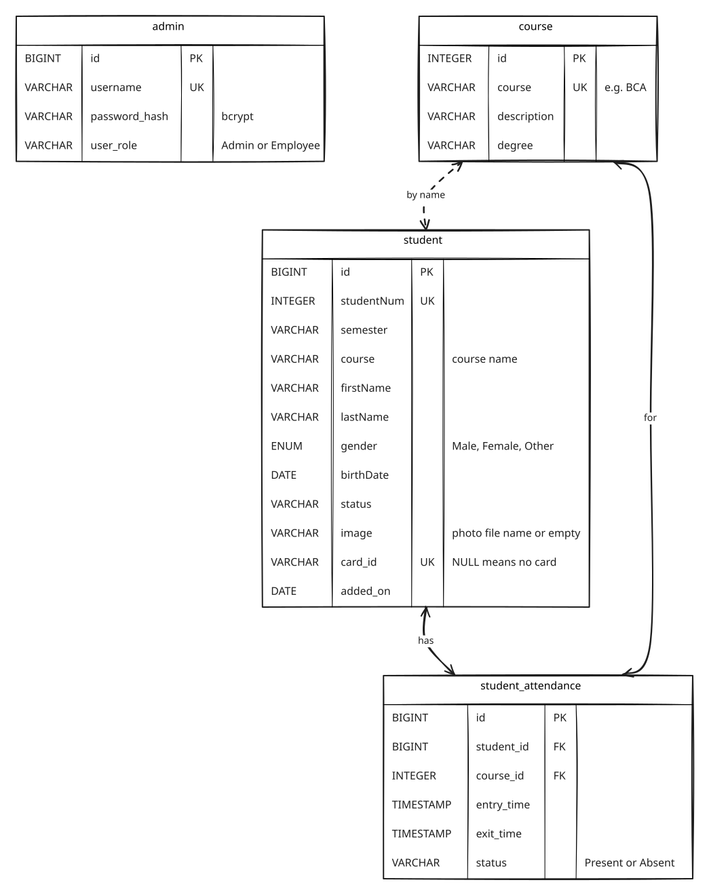

# Database

The app keeps its data in an embedded [H2](https://h2database.com) database, one file in the
per-user data folder that `AppPaths` picks for each OS. Nothing has
to be installed: on every start [Flyway](https://flywaydb.org) runs any migration in
`src/main/resources/db/migration` that hasn't run yet.

| Migration | What it does |
|---|---|
| `V1__schema.sql` | Creates the four tables below |
| `V2__demo_data.sql` | Adds two logins, three courses and a few fictional students with attendance |
| `V3__student_card_id.sql` | Adds `student.card_id VARCHAR(64)`, unique and nullable, and gives demo students 1001–1006 the cards `DEMO-1001` to `DEMO-1006` |

To change the schema, add a new `V4__what_it_does.sql`. Never edit a migration that has already
been released: Flyway checks each one's checksum and refuses to start if one has changed.

## Tables

- **admin**: the people who can log in. Only a bcrypt hash of the password is stored. An
  *Admin* can manage users; an *Employee* can't.
- **course**: the courses a student can be enrolled in.
- **student**: one row per student. `image` holds only a file name. The photo itself is copied
  into `images/` in the data folder, so the database works on any machine. `card_id` is what a
  card reader types when the student's card is scanned; two students can't share one.
- **student_attendance**: one row per entry/exit. Deleting a student deletes their attendance
  (`ON DELETE CASCADE`). A course that has attendance rows can't be deleted.

## Things worth knowing

- `student.course` stores the course **name**, not a foreign key. This is kept from the original
  schema. So the database alone doesn't stop a course from being deleted while students use it;
  `CourseService` checks for that first and throws `StillInUseException`. Making it a real foreign
  key would be a good next migration.
- Column names mix `camelCase` and `snake_case` because V1 kept the names of the original
  database, so the existing SQL didn't have to change.
- Demo logins: `admin` / `admin123` (Admin) and `employee` / `employee123` (Employee).
