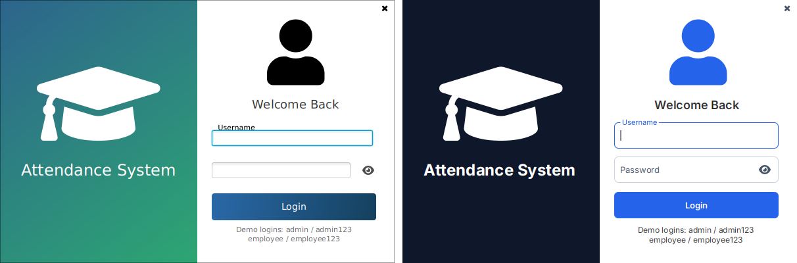
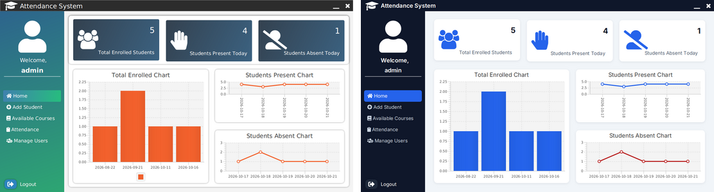

# Design decisions

Why the project is built the way it is, and what would change if a requirement changed.

## H2 instead of MySQL

The app started on MySQL, which meant installing and setting up a server before the first run.
It now uses embedded **H2**: the database is a file in the user's data folder, created on first
start. Anyone who clones the repo or downloads an installer can log in a minute later. For a
single-user desktop app that is the right trade-off, because there is no shared server to keep
running.

The cost is that two computers can't share data. If the app ever needed that, a server database
would be the move. The code is set up so that switch stays small:

1. Point the app at the server with `ATTENDANCE_DB_URL` (for example
   `jdbc:mysql://host/attendance`), `ATTENDANCE_DB_USER` and `ATTENDANCE_DB_PASSWORD`.
2. Add the JDBC driver (`com.mysql:mysql-connector-j`) and Flyway's `flyway-mysql` to `pom.xml`,
   with a matching `requires` in `module-info.java`.
3. Give MySQL its own migrations, e.g. `db/migration/mysql`, because `V1__schema.sql` uses
   H2's `GENERATED BY DEFAULT AS IDENTITY` where MySQL uses `AUTO_INCREMENT`. Then make
   `DatabaseMigrations` pick the folder from the URL.

Nothing above the DAOs changes. The DAO queries already stick to SQL that both databases accept
(`CAST(... AS DATE)`, `CURRENT_DATE`, `LIMIT ?`).

## Flyway migrations

The repo used to contain a binary `.mv.db` file and an old SQL dump that didn't match it. Now the
schema is plain SQL in `src/main/resources/db/migration`. Flyway runs any file that hasn't run
yet and records it in `flyway_schema_history`. So:

- a fresh install and an upgrade from an older version follow the same path
- schema changes are reviewed in a pull request like any other code
- tests build their databases from the same files the app uses

## DAOs and services

The original dashboard controller was 1,800 lines with SQL built by string concatenation, so a
name like `' OR '1'='1` changed what the query did. The SQL now lives in four DAOs and always
uses `PreparedStatement`. The rules (required fields, duplicates, who may delete what) live in
services. Both can be unit-tested without starting the UI, and the controllers only connect
screens to services.

A full ORM such as Hibernate would be too much for four tables. Plain JDBC keeps every query
visible.

## bcrypt for passwords

The original login already checked bcrypt hashes, and that stays. The hashing now lives in one
small class, `Passwords`, and new users get hashes with cost 12 (`jbcrypt`). Why bcrypt:

- each hash has its own random salt, so equal passwords don't give equal hashes
- the cost factor makes guessing slow even if the database file is copied

A fast hash like SHA-256 would be the wrong tool here, because speed helps the attacker.

## jpackage installers

`./mvnw -Pdist package` builds an app that doesn't need Java installed:

- `jlink` makes a trimmed Java runtime
- `jpackage` bundles that runtime with the app

The release workflow runs this on Linux (folder and `.deb`), Windows (zipped folder) and macOS
(`.dmg`) when a `v*` tag is pushed. Windows gets a zip instead of an `.msi` because an MSI needs the
WiX Toolset.

`jlink` only accepts real Java modules, and H2, Flyway and jbcrypt aren't. So the runtime holds only
JDK modules, and the libraries sit beside it on the module path.

## Staying on the latest stack

- **Java 25**, the current LTS. The Maven Enforcer plugin stops the build with a clear message on
  an older JDK. The Maven wrapper (`./mvnw`) downloads the right Maven, so only a JDK is needed.
- **Dependabot** opens a pull request each week for new library, plugin and GitHub Actions
  versions. CI tests each one on Linux, Windows and macOS before it can be merged.
- A **Java 27 CI job** runs the build on the next JDK. It is allowed to fail, and works as an
  early warning before the next upgrade.

## Known gap: database work on the UI thread

Every database call runs on the JavaFX application thread, the same thread that draws the
window. With a local H2 file and a few hundred rows this takes milliseconds, so nobody notices.
With a remote database or large tables, the window would freeze during each call.

The next step would be to run each service call in a `javafx.concurrent.Task` on a background
thread. The table would be filled in `setOnSucceeded`, which runs back on the UI thread, and an
alert shown in `setOnFailed`. The services don't touch the UI, so they would not need to change.

A second small gap: if the database can't be set up at start, JavaFX prints the error and exits.
A dialog would be friendlier.

## UI design

The old look mixed gradients and colors chosen screen by screen. The refresh changed only CSS and
small FXML spacing, so the UI tests passed unchanged.

- **Design tokens.** Every color is defined once in `theme.css` (`-color-primary`,
  `-color-surface`, `-color-text`, ...). The other stylesheets use only these names. A new
  look, or a dark mode, means editing one file.
- **Contrast.** Text colors meet WCAG AA, at least 4.5:1 against their background. For
  example, muted text `#475569` on white is about 7.6:1.
- **One font.** Inter (SIL Open Font License) ships in the app and is loaded at start, so the
  look is the same on every OS. It uses a fixed size scale: 12 / 13 / 15 / 18 / 24 px.
- **Roles, not one-offs.** Buttons come in primary, secondary and danger styles. Keyboard focus
  gets a visible ring (`:focus-visible`) that mouse clicks don't trigger. The sidebar marks the
  open screen with a style class instead of inline styles set from Java.
- **MaterialFX's own stylesheet is not loaded.** Loading it for the whole app would restyle every
  screen. So `login-style.css` styles just the two MaterialFX fields on the login screen. One
  example: their inner text box is made transparent, or it would hide the floating label.
